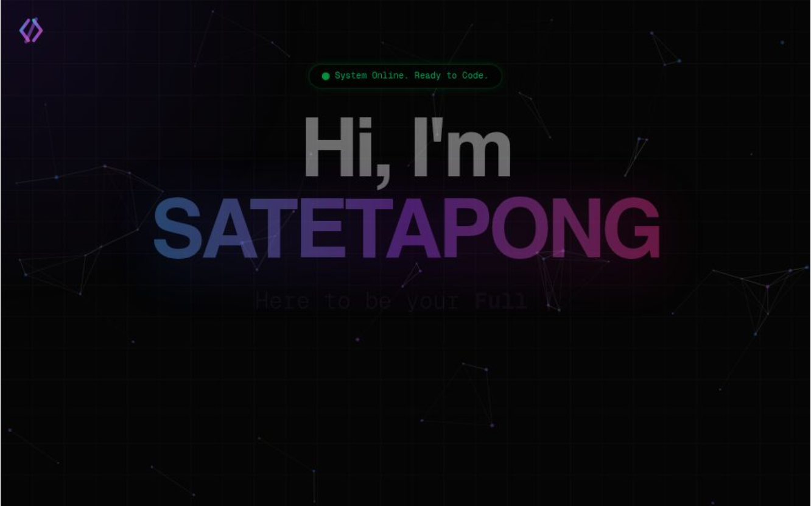

# Satetapong Sanguansuk — Personal Portfolio

A modern personal portfolio built with **React, Vite and TypeScript**.

[GitHub](https://github.com/satetapongsa) · [LinkedIn](https://th.linkedin.com/in/satetapongsa) · [TikTok](https://www.tiktok.com/@wavywvy)

## About

I'm **Satetapong Sanguansuk**, also known as **Wave** — a Computer Engineering student at
Sripatum University, Bang Khen, and a developer interested in software development, web
applications, system design, industrial automation and interactive 3D technology.

## Major Portfolio Upgrade

This repository originally contained my earlier portfolio, a Next.js + Tailwind site. It has
now been upgraded to a completely new React experience, while the full Git history and the
original files were kept (see [Legacy Portfolio Archive](#legacy-portfolio-archive)).

What's new:

- **Complete UI/UX redesign** — a dark, futuristic developer interface with a technical grid,
  ambient lighting, cursor spotlight and a custom "WAVE" identity.
- **Raw HTML opening** — the site first appears as a genuinely unstyled HTML profile page
  (no CSS applied), then…
- **Cinematic glitch boot sequence** — a 5-second "digital system failure": CRT tearing,
  RGB split, pixel-block corruption, a NO SIGNAL moment, a diagnostic terminal, then the
  interface reconstructs itself and reveals the portfolio. Skippable (button or `Esc`), and
  replaced by a calm fade for visitors who prefer reduced motion.
- **Interactive sections** — hero with a working terminal (`help`, `about`, `projects`,
  `open <n>`, `certs`, `goto <section>` …), command palette (`Ctrl/⌘ + K`), filterable project
  showcase with detail dialogs, skills, development journey timeline and contact form.
- **Résumé integration** — view or download the CV directly from the site.
- **Certificate showcase** — a Certifications & Credentials section with previews, a full-size
  viewer, downloads and issuer verification links.
- **Recovered assets** — the profile photo, résumé and certificates from the original
  portfolio are reused (see [Assets & Documents](#assets--documents)).
- **Responsive and accessible** — layouts from 320 px phones to large desktops, keyboard
  navigation, focus management in dialogs and visible focus states.

<p align="center">
  
  <br /><sub>The original portfolio, before the upgrade.</sub>
</p>

## Tech Stack

From `package.json`:

| | |
| --- | --- |
| UI | React 19 |
| Language | TypeScript |
| Build / dev server | Vite (with `@vitejs/plugin-react`) |
| Animation | Motion (`motion/react`) and CSS keyframes |
| Icons | Lucide React |
| Styling | Plain CSS with design tokens (no CSS framework) |
| Hosting | Vercel (`vercel.json` pins the Vite build) |

## Project Structure

```text
My-Portfolio/
├── index.html                 # Entry HTML — intentionally no stylesheets (raw phase)
├── public/
│   ├── favicon.svg
│   ├── assets/legacy/         # Files recovered from the original portfolio
│   │   ├── profile/           # profile.png
│   │   ├── resume/            # Resume_Satetapong_Sanguansuk.pdf
│   │   ├── certificates/      # 10 certificate images
│   │   └── other/             # unused screenshots kept for reference
│   └── projects/              # drop real project screenshots here
├── src/
│   ├── main.tsx, App.tsx      # phase orchestration (raw → boot → reveal → ready)
│   ├── Portfolio.tsx          # the styled portfolio shell
│   ├── config/boot.ts         # boot timings + diagnostic messages
│   ├── data/                  # ALL editable content: portfolio, projects, skills,
│   │                          #   journey, certificates (+ types)
│   ├── hooks/                 # useBootSequence, useActiveSection, useMediaQuery
│   ├── services/contact.ts    # contact delivery (endpoint → mailto fallback)
│   ├── styles/                # tokens, base styles, keyframes
│   ├── utils/                 # links, clipboard, lazy loaders, asset paths
│   └── components/            # RawDocument, BootSequence, Navigation, Hero, Terminal,
│                              #   About, Skills, Projects, ProjectDetails, Journey,
│                              #   Credentials, Contact, Footer, CommandPalette, ui/
├── docs/ASSET_INVENTORY.md    # where every recovered file came from and where it went
├── vercel.json
├── vite.config.ts, tsconfig.json, package.json
```

## Legacy Portfolio Archive

The original website is preserved, unchanged, on the branch:

```
archive/legacy-portfolio-before-upgrade-2026-11-03
```

The upgrade was made as a normal commit on top of the existing history — no commits were
rewritten or removed — so the old version can be browsed or restored at any time:

```bash
git checkout archive/legacy-portfolio-before-upgrade-2026-11-03
```

## Installation & Development

Requires Node.js 20+.

```bash
git clone https://github.com/satetapongsa/My-Portfolio.git
cd My-Portfolio
npm install
npm run dev          # http://localhost:5173
```

Append `?intro=skip` to the URL to jump straight to the portfolio while developing.

## Production Build

```bash
npm run build        # TypeScript check (tsc -b) + Vite production build → dist/
npm run preview      # serve the production build locally
npm run typecheck    # TypeScript only
```

## Assets & Documents

| What | Where | Shown in |
| --- | --- | --- |
| Profile photo | `public/assets/legacy/profile/profile.png` | About section |
| Résumé / CV | `public/assets/legacy/resume/Resume_Satetapong_Sanguansuk.pdf` | About ("View My CV", "Download Resume"), hero, command palette |
| Certificates (10) | `public/assets/legacy/certificates/` | Certifications & Credentials section |
| Project screenshots | `public/projects/` (empty — add real screenshots and set `cover.src` in `src/data/projects.ts`) | Project cards |

See [`docs/ASSET_INVENTORY.md`](docs/ASSET_INVENTORY.md) for the full mapping.

## Editing content

Everything personal lives in `src/data/`:
`portfolio.ts` (identity, bio, contact, socials, résumé), `projects.ts`, `skills.ts`,
`journey.ts` and `certificates.ts`. Components never hard-code personal information.

---

Designed & Developed by Wave.
